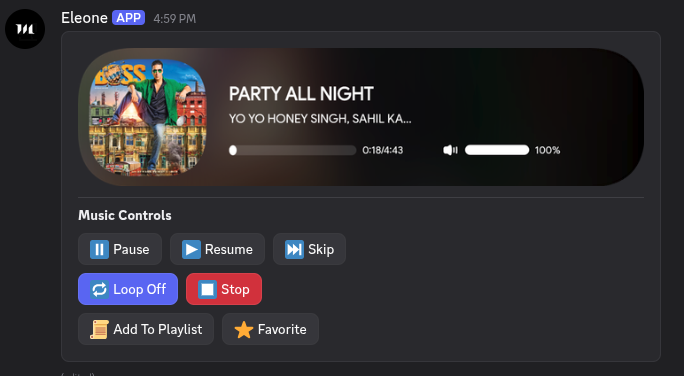

# Eleone Discord Music Bot

Production-grade prefix-based Discord music bot with Lavalink + Shoukaku, Supabase-backed settings, Spotify integration, premium systems, playlists/favorites, AFK/general utilities, and Components V2 UI.

[](https://discord.gg/TGF3fCXtRm)

## Highlights

* Node.js `>=20`
* Discord.js v14
* Lavalink v4 via Shoukaku
* Spotify track/playlist resolve
* Supabase persistence (prefix, premium, playlists, favorites, AFK, etc.)
* Components V2 response layout
* Per-guild prefix + music channel lock
* No-prefix system (owner-managed)
* Vote premium + buy premium (token redeem)
* Music cards + controls + custom emojis
* 24/7 mode (premium)
* Cloud playlists + favorites
* AFK (server/global) with auto-clear + DM alert

---

## Project Structure

```text
src/
  bot.js
  index.js
  commands/
  components/
  config/
  database/
  favorites/
  filter/
  general/
  handlers/
  lavalink/
  music/
  musiccard/
  playlists/
  premium/
  services/
  settings/
  spotify/
  utility/
  utils/
  voiceplay/

database/
  README.md
  supabase.sql
  supabase_vote_premium.sql

docs/
  screenshots/

website/

.env.example
package.json
```

---

## Installation

Install dependencies:

```bash
npm install
```

Copy the environment template:

```bash
cp .env.example .env
```

Windows PowerShell:

```powershell
Copy-Item .env.example .env
```

Then configure your `.env` file with your Discord, Supabase, Lavalink, Spotify, and other required credentials.

---

## Environment Variables (`.env`)

### Required

* `DISCORD_TOKEN`
* `SUPABASE_URL`
* `SUPABASE_KEY`
* `LAVALINK_HOST`
* `LAVALINK_PORT`
* `LAVALINK_PASSWORD`
* `SPOTIFY_CLIENT_ID`
* `SPOTIFY_CLIENT_SECRET`
* `BOT_OWNER_ID`
* `NO_PREFIX_LOG_CHANNEL_ID`

### Common Optional

* `LAVALINK_SECURE`
* `LAVALINK_IDENTIFIER`
* `LAVALINK_RECONNECT_TRIES` (default `999999`)
* `LAVALINK_RECONNECT_INTERVAL_MS` (default `5000`)
* `VOICE_CHANNEL_STATUS_ENABLED`
* `TOPGG_TOKEN`
* `GUILD_LOG_CHANNEL_ID` (join/leave server log channel ID)
* `VOTE_PREMIUM_HOURS` (default `12`)
* `PREMIUM_VOTE_LOG_CHANNEL_ID`
* `PREMIUM_BUY_URL`
* `TOPGG_VOTE_URL`
* `SPOTIFY_SEARCH_CONCURRENCY`
* `PLAY_SEARCH_CACHE_TTL_MS`
* `VOTE_EXPIRY_CHECK_MS`
* `VOTE_EXPIRY_BATCH_LIMIT`

### Premium Lavalink Nodes

Premium Lavalink nodes are optional:

* `PREMIUM_LAVALINK_NODES_JSON`
* `PREMIUM_LAVALINK_SSL_*`
* `PREMIUM_LAVALINK_NONSSL_*`

### Custom Control Emoji Variables

* `MUSIC_BTN_PAUSE_EMOJI`
* `MUSIC_BTN_RESUME_EMOJI`
* `MUSIC_BTN_SKIP_EMOJI`
* `MUSIC_BTN_LOOP_EMOJI`
* `MUSIC_BTN_STOP_EMOJI`
* `MUSIC_BTN_PLAYLIST_EMOJI`
* `MUSIC_BTN_PLAYLIST_ADD_EMOJI`
* `MUSIC_BTN_FAVORITE_EMOJI`
* `MUSIC_BTN_FAVORITE_ADD_EMOJI`

---

## Supabase Setup

The SQL files are stored in the `database/` directory.

Run them in the following order using the **Supabase SQL Editor**:

1. `database/supabase.sql`
2. `database/supabase_vote_premium.sql`

### Step 1 — Main Database

Open:

```text
database/supabase.sql
```

Copy its contents into the Supabase SQL Editor and execute it.

### Step 2 — Vote Premium

After the main database setup has completed, open:

```text
database/supabase_vote_premium.sql
```

Copy its contents into a new Supabase SQL Editor query and execute it.

> Always run `supabase.sql` before `supabase_vote_premium.sql`.

For more detailed database setup instructions, see:

```text
database/README.md
```

### Database Objects

The SQL setup creates or updates the following database objects:

* `guilds`
* `no_prefix_users`
* `user_premium_profiles`
* `guild_vote_premium`
* `premium_tokens`
* `user_spotify_profiles`
* `playlists`
* `playlist_tracks`
* `playlist_settings`
* `user_favorites`
* `afk_global`
* `afk_guild`
* `afk_nicknames`

> Before running SQL against an existing production database, review the queries and back up important data.

---

## Run

Production:

```bash
npm start
```

Development:

```bash
npm run dev
```

---

## Command Categories

### Music

* `play`
* `pause`
* `resume`
* `skip`
* `stop`
* `disconnect`
* `queue`
* `nowplaying`
* `volume`
* `loop`
* `lyrics`

### Filters

* `filter`
* Filter presets
* `filter list`
* `filter off`

### Settings

* `prefix`
* `musicchannel`
* `config`

### Utility

* `help`
* `ping`
* `stats`
* `uptime`
* `botinfo`
* `serverstats`
* `voiceinfo`
* `shardinfo`
* `system`
* `support`
* `invite`

### Spotify

* `spconnect`
* `spstatus`
* `spplaylists`
* `spplay`
* `spdisconnect`

### Playlists

`playlist`

Includes:

* create
* list
* add
* view
* load
* import
* export
* share
* autosync
* autoload
* and more

### Favorites

`favorite`

Includes:

* add
* list
* play
* play all
* remove
* queue add

### Premium

* `vote`
* `mypremium`
* `myprefix`
* `mycard`
* `247`
* `premiumtoken`
* `premiumredeem`

### General

* `afk`
* `avatar`

### Owner / Access

* `noprefix`

---

## Premium Logic

### Vote Premium — Top.gg

* User votes for the bot on Top.gg.
* The `vote` command synchronizes the user's premium state.
* Default vote premium duration is 12 hours.
* Duration can be configured using `VOTE_PREMIUM_HOURS`.
* When premium expires, the bot can send a DM reminder containing a vote button.
* Re-voting and using `vote` reactivates the premium features.

### Buy Premium — Guild

* The bot owner generates a premium token using `premiumtoken`.
* A guild administrator redeems the token using `premiumredeem`.
* Guild premium features are activated according to the token's configured duration.

---

## Music Channel Lock

The `musicchannel` command allows a server to restrict music commands to a specific text channel.

### Set

```text
musicchannel set #channel
```

### Show

```text
musicchannel show
```

### Clear

```text
musicchannel clear
```

When enabled, music/playback-related commands can only be used in the configured channel.

---

## AFK System

The `afk` command opens an interactive AFK configuration.

Features include:

* Server AFK
* Global AFK
* `[AFK]` nickname support
* Automatic nickname restoration
* AFK reason
* AFK timestamp
* Avatar display
* Mention/reply detection
* DM notifications
* Automatic AFK removal when the user sends a message

The bot must have the required permissions to modify nicknames.

---

## Voice Channel Song Status

When a track starts playing, the bot can update the voice channel status with the current song.

Enable it using:

```env
VOICE_CHANNEL_STATUS_ENABLED=true
```

The status is cleared when:

* Playback stops
* The bot disconnects
* The queue ends

---

## Spotify

Spotify URL resolving uses the Spotify Web API with Lavalink search fallback.

Features include:

* Track resolving
* Playlist resolving
* Playlist imports
* Chunked playlist processing
* Search concurrency optimization
* Search result caching

Performance can be configured using:

```env
SPOTIFY_SEARCH_CONCURRENCY=6
PLAY_SEARCH_CACHE_TTL_MS=120000
```

---

## Components V2 UI

Bot responses use Discord Components V2 layouts where supported.

Interactive panels can include:

* Buttons
* Select menus
* Pagination
* Media galleries
* Music cards
* Playback controls
* Custom emojis

---

## Troubleshooting

### Bot Online but Commands Do Not Respond

Check the following:

1. Enable the **Message Content Intent** in the Discord Developer Portal.
2. Verify the configured prefix using `prefix` or `config`.
3. If `musicchannel` is enabled, make sure the command is being used in the configured channel.
4. Check the bot logs for command or database errors.

### Lavalink Reconnect / 403 Errors

Check:

* Lavalink host
* Lavalink port
* Lavalink password
* `LAVALINK_SECURE`
* Lavalink node availability
* Network connectivity
* Lavalink v4 compatibility

Example:

```env
LAVALINK_HOST=your-host
LAVALINK_PORT=2333
LAVALINK_PASSWORD=your-password
LAVALINK_SECURE=false
```

### Spotify Errors

Verify:

* `SPOTIFY_CLIENT_ID`
* `SPOTIFY_CLIENT_SECRET`

Make sure the Spotify application is active and its credentials have not been revoked.

### Supabase Errors

Check:

* `SUPABASE_URL`
* `SUPABASE_KEY`

If the database schema has changed, review and re-run the appropriate SQL file from:

```text
database/
```

### Missing Premium Features

Check:

* `TOPGG_TOKEN`
* `VOTE_PREMIUM_HOURS`
* Premium log channel configuration
* Vote status
* Supabase premium tables

After voting, run:

```text
vote
```

---

## Deployment

Node.js 20 or newer is required.

For production:

* Keep `.env` private.
* Never commit real tokens, API keys, passwords, or client secrets.
* Use PM2, systemd, Docker, or another suitable process manager.
* Keep Lavalink reachable from the bot server.
* Use a production Supabase project with appropriate backups and security policies.

Example with PM2:

```bash
pm2 start src/index.js --name eleone
pm2 save
```

---

## Security

Never commit:

```text
.env
```

or any file containing:

* Discord bot tokens
* Supabase service keys
* Lavalink passwords
* Spotify client secrets
* Top.gg tokens
* Other private credentials

Use `.env.example` as the safe template for required environment variables.

---

## UI Showcase

<p align="center">
  
</p>

---

## License

This project is licensed under the **Eleone Custom Non-Commercial License**.

- Non-commercial use only.
- No selling or resale.
- No commercial hosting or monetization.
- Required credit to the original Owner.
- No claiming the project as your own.
- Commercial use requires explicit written permission.

See the [`LICENSE`](./LICENSE) file for the complete terms.
